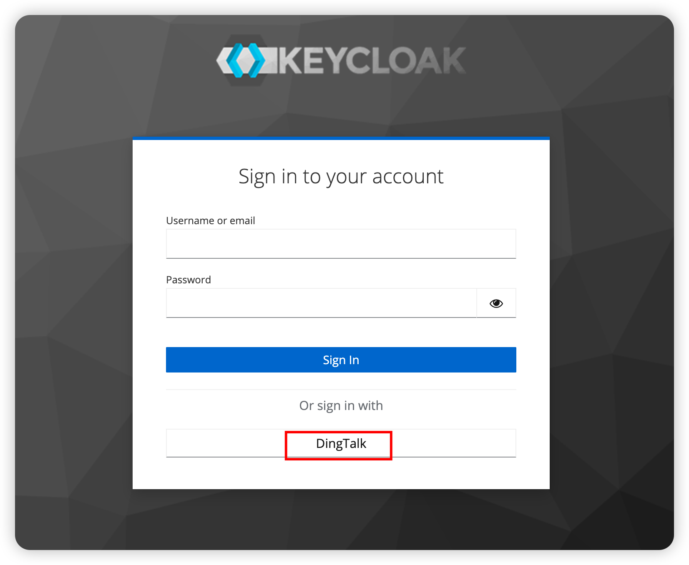
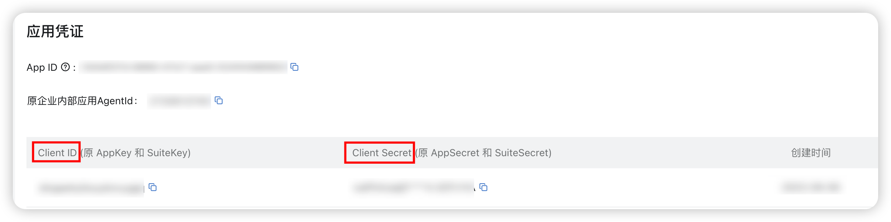
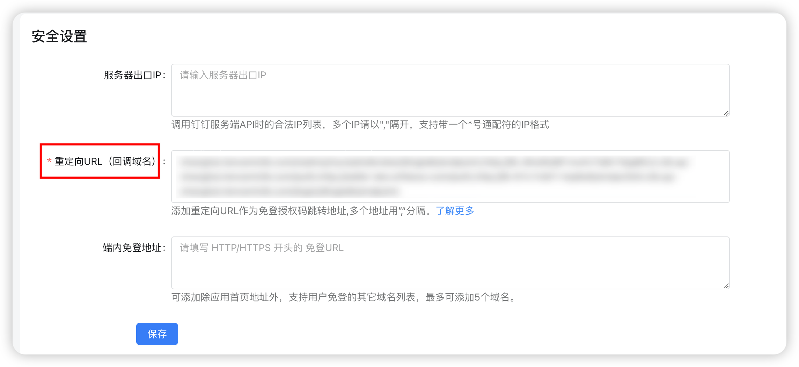
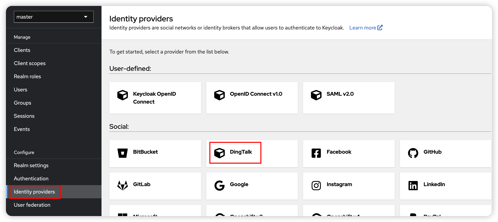
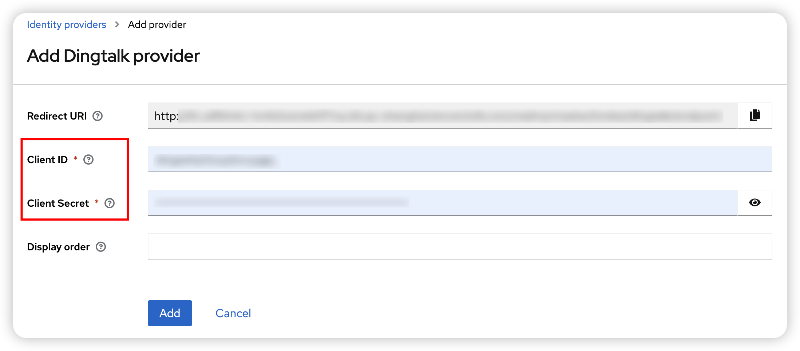
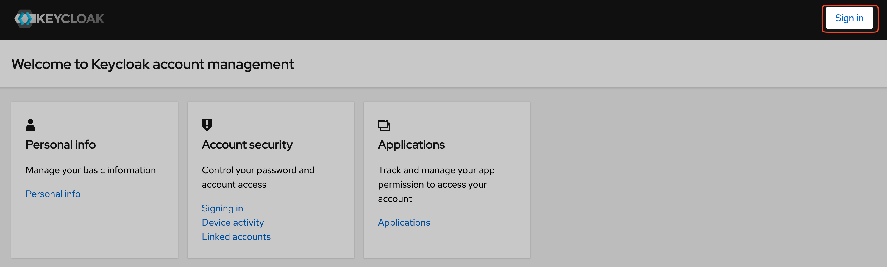
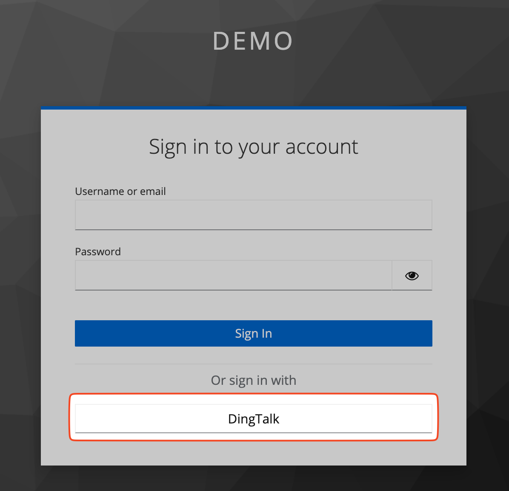
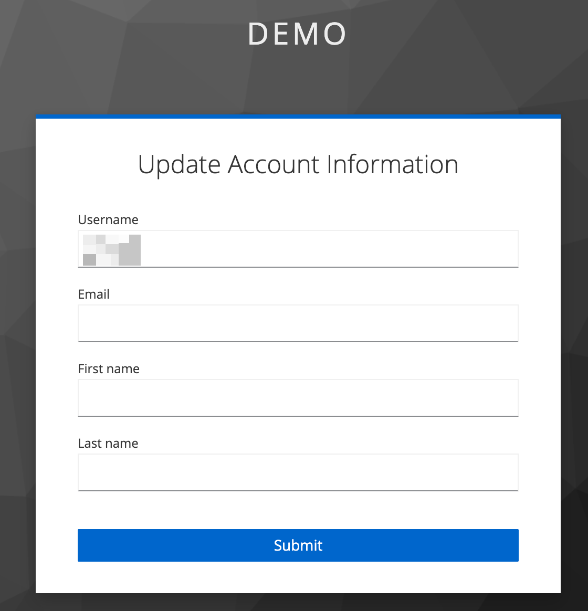

# keycloak-dingtalk-social-identity-provider

Keycloak Social Login 插件（IDP） —— 钉钉登陆。

> Keycloak HA 部署至 Kubernetes 集群，可参考如下文档：
>
> [🔗 GitBook](https://yangsijie151104.gitbook.io/keycloak-on-k8s-ha-bu-shu/)
>
> [🔗 CSDN](http://t.csdnimg.cn/f2PZr)
>
> [🔗 掘金](https://juejin.cn/post/7366836510690672675)
>
> [🔗 Notion](https://believed-stallion-f40.notion.site/Keycloak-on-K8S-HA-e19576ca2cd448338debf66a16e9b6a6?pvs=4)

## 🌟 效果



## ⚙️ 安装

此版本面向 Keycloak `26.8.2`，构建和运行时应使用相同版本的 Keycloak。

### 🤖 源码构建

在项目根目录使用 JDK 17 或更高版本及 Maven 构建 JAR。

```shell
mvn -B -ntp clean package
```

产物为 `target/keycloak-dingtalk-social-identity-provider-26.8.2.jar`。
如果使用解压版 Keycloak，将它复制到 `$KEYCLOAK_HOME/providers/`，再运行 `kc.sh build`（Windows 使用 `kc.bat build`）。

### 🎃 容器部署

先构建 JAR，再在项目根目录运行下方命令。Dockerfile 会将 `target/` 中的 JAR 复制到官方镜像 `quay.io/keycloak/keycloak:26.8.2` 的 `/opt/keycloak/providers/`，再运行 `kc.sh build`。

```shell
docker build -t keycloak-dingtalk:26.8.2 .
```

本地联调默认使用 `dev-file` 数据库。构建生产 PostgreSQL 镜像时，指定数据库并使用独立标签。

```shell
docker build --build-arg KEYCLOAK_DB=postgres -t keycloak-dingtalk:26.8.2-postgres .
```

生产容器使用 `start --optimized` 启动，并按部署环境配置数据库连接和 HTTPS 入口。仓库中的 `k8s.yaml` 是旧版镜像的示例，升级时需更新镜像及运行参数。

## 🛠️ 配置

### 🥙 钉钉

参照[钉钉文档](https://open.dingtalk.com/document/orgapp/tutorial-obtaining-user-personal-information)在钉钉侧配置用于登陆的应用信息，从钉钉应用中可以获取 `clientId` 和 `clientSecret` 信息。



并在该应用下配置登陆后的 **重定向 URL**。

> ⚠️ 该配置需等 Keycloak 中配置完 DingTalk 登陆插件后，再配置。



### 🧀 Keycloak

在目标 Realm（这里） 中选择 Identity Providers，选择 `DingTalk`。



在配置页填入从钉钉侧获取的 `ClientId` 和 `ClientSecret`。

> 这里的 **Redirect URI** 即用来复制粘贴进钉钉侧的 **重定向 URL**。



在钉钉应用的权限管理中开通 `Contact.User.Read`，并将 Keycloak 中该身份提供者的 **Default Scopes** 设置为 `openid Contact.User.Read`，以便读取登录用户的个人信息。

## 💪 使用

登录目标 realm，链接为 `http://localhost:8080/realms/demo/account/`。

点击 `Sign in` 跳转到登陆页。



点击 `DingTalk` 即可跳转到钉钉登陆页。



> 若用户在 Keycloak 中未注册，登陆后会跳转至注册页。
> 

## ⭐ Star History

如果这个项目对你有帮助，请给我们一个 ⭐！

[](https://star-history.com/#yangsijie666/keycloak-dingtalk-social-identity-provider&Date)

---

<div align="center">
  <p>Made with ❤️ by the yangsijie666</p>
  <p>如果你喜欢这个项目，请考虑给一个 ⭐</p>
</div>
